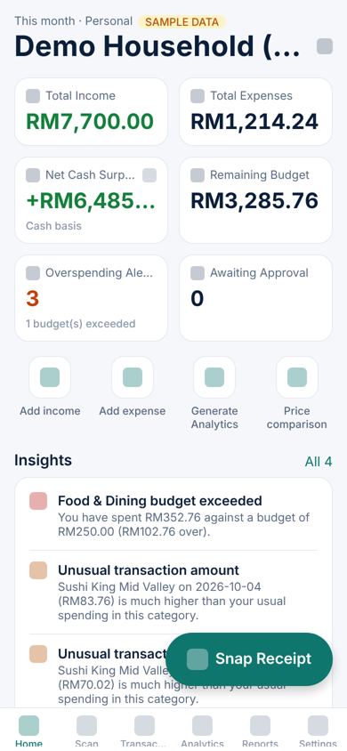
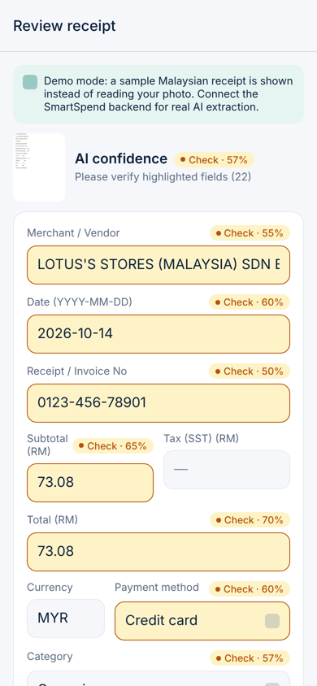
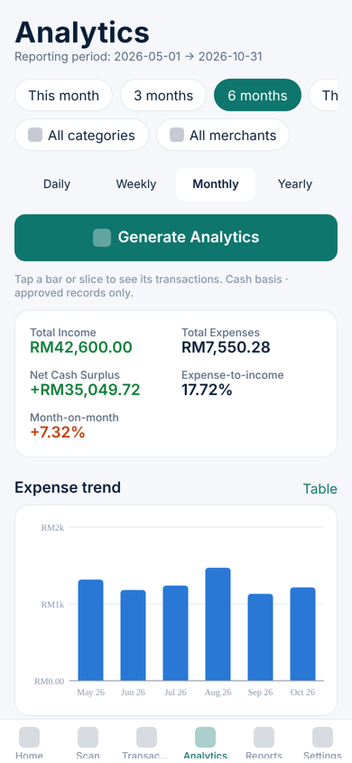
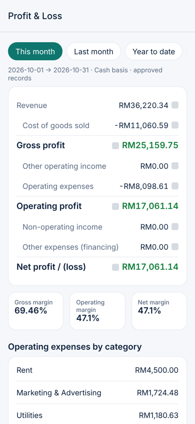
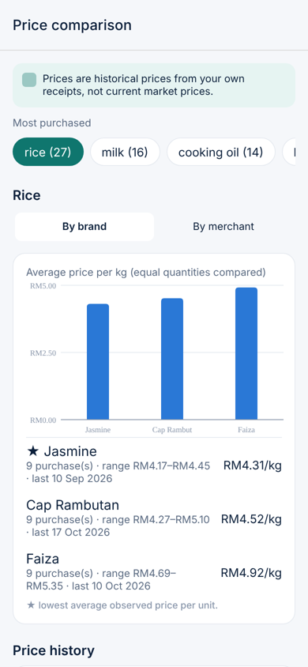

# SmartSpend AI — Intelligent Expense & Financial Management

> *Professional accounting intelligence with the simplicity of taking a photograph.*

Snap a receipt → AI reads it → you confirm → it's recorded, categorised, budget-checked, synced to Google Sheets and ready for audit-grade reports. For individuals and Malaysian businesses. MYR by default, English and Bahasa Malaysia.

This folder is a working **Phase 1 product** (plus most of Phase 2): an iOS app (Expo / React Native / TypeScript), a secure Firebase backend, and a shared, tested financial engine.

| Home (personal) | AI receipt review | Analytics | Profit & Loss | Price comparison |
|---|---|---|---|---|
|  |  |  |  |  |

<sub>Screenshots are from the web build of the demo mode, rendered headlessly. On iOS the grey squares are SF Symbols icons.</sub>

## What's here

```
smartspend-ai/
├── packages/core/     Shared domain engine (pure TypeScript, 46 unit tests)
│                      money · receipt validation · OCR fallback parser · categoriser (learns)
│                      duplicates · unit-price normalisation · price comparison · P&L / cash engine
│                      analytics · budgets & alerts · explainable insights · hash-chained audit trail
│                      RBAC & approval workflow · Google Sheets mapping · 10 report types · CSV import · EN/BM strings
├── functions/         Firebase Cloud Functions (19 endpoints) + emulator tests (26 tests)
│                      Gemini extraction (+ Cloud Vision fallback) · transactions/approvals/amendments
│                      Google OAuth (server-side tokens) · Sheets/Drive sync · PDF/XLSX/CSV/ZIP reports
├── apps/mobile/       Expo SDK 58 iOS app — 27 screens, offline outbox, Face ID, demo mode
├── firebase/          Firestore & Storage security rules, indexes
├── evidence/          Generated verification report + sample PDF/XLSX/CSV/ZIP outputs
└── docs/              Architecture, setup, deployment, App Store checklist, screenshots
```

## Try it in 2 minutes (no credentials)

```bash
cd smartspend-ai
npm install
npm run start -w @smartspend/mobile        # scan the QR code with Expo Go on your iPhone
```
Tap **Explore with sample data**. The demo runs entirely on the phone with a clearly-labelled sample personal household and a sample company (with employees, approvals, departments, budgets). Sample data lives in its own workspaces and can never sync to Google or mix with real records. In demo mode, scanning shows a sample Malaysian receipt instead of reading your photo (real AI extraction needs the backend).

## Verify it

```bash
npm test -w @smartspend/core                                    # 46 unit tests
npx firebase emulators:exec --only firestore,storage,auth \
  --project demo-smartspend "npm test -w @smartspend/functions"  # 26 backend + security-rules tests
npm run evidence                                                # writes evidence/EVIDENCE.md + sample reports
npm run typecheck                                               # core, functions, mobile
```
See [`evidence/EVIDENCE.md`](evidence/EVIDENCE.md): extraction results, duplicate prevention, idempotent Sheets sync (2nd sync appends 0 rows), month-by-month reconciliation, and 8 report types matching recorded totals.

## Go live

1. **Backend & credentials** → [`docs/SETUP.md`](docs/SETUP.md). It covers everything that needs your accounts, paid APIs or approvals: Firebase (Blaze plan), Gemini API key, Google OAuth consent screen (Sheets scope verification), Apple Developer Program, and Sign in with Apple.
2. **iOS build, TestFlight, App Store** → [`docs/DEPLOYMENT.md`](docs/DEPLOYMENT.md) and [`docs/APP_STORE_CHECKLIST.md`](docs/APP_STORE_CHECKLIST.md).
3. **How it fits together** → [`docs/ARCHITECTURE.md`](docs/ARCHITECTURE.md). For what's done and what's next, see [`docs/ROADMAP.md`](docs/ROADMAP.md).

## Important limitations

- Reports are management and audit-*preparation* documents on a **cash basis**. They are **not** certified or audited financial statements and do not by themselves guarantee LHDN/SSM/MFRS compliance. Have a professional review them.
- Price comparisons use **historical prices from your own receipts**, never live market prices. When there isn't enough data, the app says *"Insufficient comparison data"* rather than estimating.
- AI never fills in values that aren't printed. Uncertain fields are highlighted, and nothing is saved until you confirm it.
- Nothing here has been run on a physical iPhone. The iOS JavaScript bundle compiles, the screens were rendered and exercised in a browser build, and the backend was tested on the Firebase emulators. The native modules (VisionKit scanner, Face ID, Apple and Google sign-in) still need a device test in a development build.
